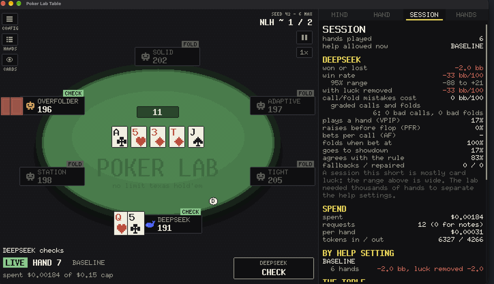

# LLM Poker Lab

A controlled lab for measuring how language models play six-handed no-limit Texas hold'em, and above all **how they learn**: whether a model gets better at a table as it sees more hands, what kind of memory or training makes that happen, and what it costs.

## Why

Language models can describe poker strategy fluently; whether that turns into winning play is an open question (see [related papers](docs/papers.md)). Poker is a good test because it needs probabilistic judgment, reading opponents, remembering what matters, and adapting, all under hidden information. The lab's goals:

1. **Understand how models learn** (the central question): within a session (notes, statistics, adapting to an opponent who adjusts), across sessions (persistent profiles), and through training (fine-tuning). Which of these turns experience into better play?
2. **Find what explains a model's results**, not just who wins: computation (facts, odds), opponent information (notes, statistics, accurate profiles), bet sizing, thinking, and the harness around the model.
3. **Measure decisions, not luck**: paired deals, all-in luck removal, and grades of each decision against the best available choice.
4. **Use opponents with known answers**: scripted bots whose exploits are written down, plus a tuned-bot ceiling, so a model's "read" can be checked.
5. **Report cost beside strength**, and keep everything replayable.

Details: [design](docs/design.md).

## What we know so far

**Inkling 2 Mini is the current local model.** Its latest study completed every section in 7.7 hours, with $0 API fees: 64 main/repeat games comparing six versions, memory across sessions, 512 skill questions and separate exploration and code-only tests. [Plain-language findings](results/12-inkling-own-choice/takeaways.md), [full results](docs/results.md).

- **It can use new evidence during play.** Updating reads beat freezing them after an opponent changed, in both directions and both samples. These own-choice comparisons are descriptive; weights stayed unchanged.
- **Recent counts plus a calculator performed best among the four main setups.** This version uses code for both steps. A calculator alone improved the average, but missed the predeclared rule requiring both samples' intervals above zero.
- **Keeping notes across sessions and occasional information-gathering bets had no clear overall benefit.** More memory was not automatically better.
- **Fine-tuning remains untested.** Supplying calculated chip values removed all errors in the limited betting exam. The exam split was imbalanced; fix that before a training study. [Simple next steps](ROADMAP.md#next-experiment)
- **Earlier API results still matter.** Facts, opponent profiles and sizing rules helped DeepSeek and GLM. GLM's apparent learning gain failed replication. Qwen's local pilot did not show adaptation. Those results and the percentage-format correction are recorded in [results](docs/results.md).

The current evidence is from simple scripted opponents and river decisions. General learning at a full six-seat table remains open.



## Quick start

The lab uses Rust. OpenRouter reads credentials from `OPENROUTER_API_KEY` or a git-ignored `.openrouter-api-key`.

```sh
cargo test                                                    # engine, protocol, analysis (no API calls)
cargo run -- 6 100 42 /tmp/poker-run                          # scripted six-seat session, no model
cargo run --release -- openrouter examples/1-pilots/pilot.json runs/my-pilot          # one model session
cargo run --release -- batch examples/6-lineup/deepseek-none.json runs/my-batch       # a parallel batch
cargo run --release -- analyze runs/my-batch --turn           # style, win rates, luck removal, grades
cargo run --release -- compare runs/a runs/b --seat 0 --turn  # arms of several runs side by side
cargo run --release -- catalog runs > results/runs.csv        # one row per run
cargo run --release -p poker-table                            # watch a model play (add --mock for free)
```

### Play with a local model

With Inkling loaded in `llama-server` on port 9932, run one six-hand orbit. The model writes notes after hands three and six.

```sh
cargo run --release -- openrouter examples/10-inkling/smoke-answer-only.json runs/my-inkling-smoke
```

The session CLI and batch pilot accept `local_port` and use the server's model alias. Local requests go directly to loopback without an API key. The lab sends temperature 0 for reproducibility. Token usage and request limits still apply. Each new session starts with empty notes. Qwen/Pi on port 9931 remains available through `examples/9-local-pi/smoke.json`.

Inkling's `local_json_prefill` option starts a JSON answer directly so reasoning does not consume the short answer limit. To repeat the small river pilots:

```sh
POKER_MODEL=inkling-2-mini POKER_MODEL_URL=http://127.0.0.1:9932/v1/chat/completions \
  POKER_TEMPLATE_KWARGS='{"reasoning_effort":"none"}' POKER_JSON_PREFILL=1 \
  POKER_KEEP_PRIOR_ON_NOTE_FAILURE=1 \
  python3 -B experiments/local_suite.py runs/inkling-local-suite-new
```

To repeat the overnight study in a new directory, or resume it using the same directory:

```sh
python3 -B experiments/run_inkling_overnight.py runs/my-inkling-overnight results/my-inkling-overnight
```

The supervisor keeps the Mac awake and saves each response for recovery. The report marks whether the study completed. Full command reference: [methods](docs/methods.md).

The own-choice study is **complete**. `python3 -B experiments/run_inkling_own_choice.py` only prints its offline plan. Inference requires `--execute`; repeating the study needs fresh output directories. [Results and data](results/README.md).

## Repository map

| Path | What |
| --- | --- |
| `src/` | The lab: engine, bots, model agent, worker supervision, batches, analysis, graders |
| `table/` | The spectator table (separate workspace crate) |
| `examples/<topic>/` | Every config that was run, grouped by topic |
| `runs/<topic>/` | Raw run data (git-ignored, about 3.5 GB; private: contains seeds and hidden cards) |
| `results/` | Small, readable outputs kept in git: run catalog, analyses, comparisons |
| `docs/` | [design](docs/design.md), [methods](docs/methods.md), [results](docs/results.md), [model input](docs/model-input.md), [table](docs/table.md), [papers](docs/papers.md) |
| `ROADMAP.md` | Done, open gaps, next experiments |

Topics, in order: `1-pilots`, `2-thinking-off`, `3-qwen`, `4-table`, `5-thinking-low`, `6-lineup`, `7-glm-varied`, `8-glm-learning`, `9-local-pi`, `10-inkling`, `11-inkling-overnight`, `12-inkling-own-choice`. These names match the sections of [results](docs/results.md). Standalone pilot run directories may use their original names.
