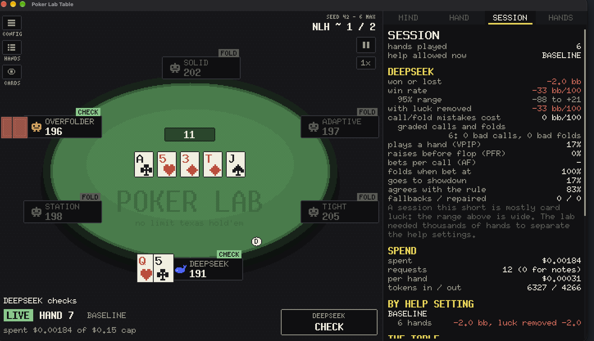

# Spectator table (`poker-table`)

A retro pixel-art poker table for watching one model play six-handed against the lab's scripted field. Pure Rust, in the workspace crate `table/`. It plays with the lab's own engine, opponents, model agent, decision aids, memory and evaluators; nothing is re-implemented. Built 2026-11-14 and run live against DeepSeek the same day (results below).



## Running it

From the repository root (so `.openrouter-api-key` and `runs/` are found):

```sh
cargo run --release -p poker-table                 # choose player and help, then START GAME
cargo run --release -p poker-table -- --mock       # model is a local mock: free, offline, canned reasoning
cargo run --release -p poker-table -- --open runs/memory-structured-v1/session-001   # replay a saved lab session
cargo run --release -p poker-table -- --snapshot /tmp/shots   # write a picture of every screen, no window
```

Keys: `space` pause/resume, `c` settings, `h` show all hole cards, `tab` or `1`-`4` panel tabs, `left`/`right` step through hands, `up`/`down` previous/next hand, `l` or `esc` back to live, `+`/`-` speed.

## What is on screen

- **Table**: the watched seat at the bottom (whale avatar for DeepSeek, robots for everything else), bets, pot, dealer button, last action per seat.
- **MIND**: for the decision on screen, what the model was sent (cards, legal moves, facts sheet, notes), its reasoning, its move, latency, cost and provider. Taken from the agent's audit stream, so it is exactly what was sent and received.
- **HAND**: result, all-in-adjusted result, each decision with equity against the cards actually held, pot-odds grade, EV of calling, and the reference rule's choice. Click a decision to jump to it.
- **SESSION**: the lab's `analyze` row for every seat (win rate, luck-adjusted, VPIP, PFR, AF, mistake cost, rule agreement), spend, totals per help setting, and the lab's measured reference numbers.
- **HANDS**: every finished hand; click to replay.

## Settings (before the game and during a pause)

| Setting | Lab meaning |
| --- | --- |
| Facts sheet | `scaffold: features` |
| Cheat sheet | `memory: oracle` |
| Own notes | `memory: notes`, `notebook_style: structured_profiles` |
| Baseline | none of the above |
| Show thinking | `reasoning_enabled: true`, `max_tokens: 4096`, 90 s timeout |
| Reset each | `reset_stacks: true` (the experiments' setting); default is carry-over |
| Cap | `spend_limit_usd` for the whole table session (default $0.25) |

Cheat sheet and own notes exclude each other, as in the lab's memory conditions. Changes apply from the next hand; the model's own notes are carried across a change. Field, request settings and provider pinning match `examples/experiment-memory-structured.json`.

**Thinking is not the measured setup.** Every lab result was run with reasoning off. With it on, the model may play differently and each decision costs about 12 times more (see the first live run). With it off, MIND shows what the model saw and its move, but no reasoning, because none exists.

## First live run (2026-11-14, `runs/table-1794705445`)

`deepseek/deepseek-v4.1-flash-1017`, baseline (no help), thinking on, carry-over stacks, seed 42, $0.15 cap.

| Measure | Value |
| --- | --- |
| Hands / model decisions | 13 / 27 |
| Decisions with reasoning text returned | 27 of 27 |
| Fallbacks, provider failures | 0, 0 |
| Provider | DeepInfra for every request (the first pinned provider accepted `reasoning.enabled: true`) |
| Median response time | 2.9 s |
| Reasoning tokens | about 390 per decision |
| Cost | $0.0044 total: about $0.00017 per decision, $0.00034 per hand |

With thinking off and the same provider, a decision cost about $0.000014 in the structured-notes run, so thinking is roughly 12 times dearer per decision. At this rate $1 buys about 3,000 hands with thinking on.

This run only shows that the live path works. Thirteen hands say nothing about how well the model plays, and nothing about whether thinking changes its play; that needs a paired experiment (thinking on vs off on the same seeds).

## Design

- `dealer.rs` plays a hand step by step with `engine::Hand`. A test checks its records equal `arena::Session`'s on the same seed, and every hand passes `arena::replay`.
- `frames.rs` turns a hand into table pictures; a test checks each picture against the referee's state on random hands (chips conserved, stacks and bets equal).
- `session.rs` is the game thread: builds the model seat from the settings, paces play, freezes on pause, taps the audit stream, and keeps `analyze::Tally` per seat.
- `analysis.rs` calls `evaluation::grade_seat`, `allin_adjusted` and `scaffold::suggestion`; a test checks its numbers equal the lab's.
- `canvas.rs`, `tableview.rs`, `app.rs`: a 720x405 software framebuffer with bitmap fonts and pixel sprites, shown through `winit` + `softbuffer` at a whole-number scale.
- Each stretch of settings is saved as `runs/table-<time>/session-NNN` in lab format, so `poker-lab analyze` and `poker-lab report` read it.

Lab changes: `analyze::Tally`, `Tally::style`, `analyze::tally` are public; `OpenRouterAgent::take_memory` / `restore_memory` were added.

## Limits

- Six seats, one model seat, the fixed five-bot field. No mixed-model table yet.
- Reasoning arrives when the response does (requests are not streamed), then is typed out.
- A pause takes effect at the next action; a request already sent completes first.
- Raises and bets are not graded (the lab has no model of how opponents respond).
- A session of a few dozen hands says almost nothing about win rate; the SESSION tab shows the 95% range to make that visible.
