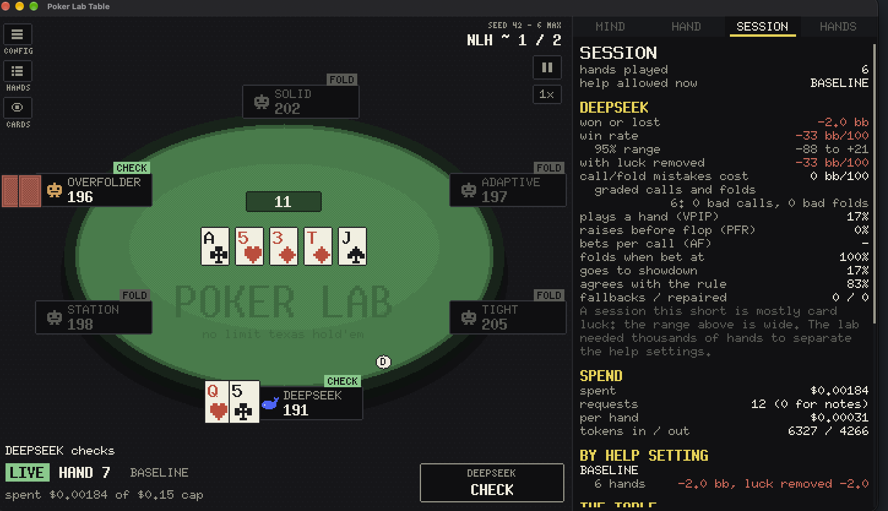

# Spectator table (`poker-table`)

A retro pixel-art table for watching one model play six-handed against the lab's bots. Workspace crate `table/`, pure Rust; it uses the lab's own engine, bots, model agent, aids, memory and graders. Session results from it are in [results §4](results.md#4-spectator-table-sessions-2026-11-14-to-11-15).



## Running

From the repository root (so `.openrouter-api-key` and `runs/` are found):

```sh
cargo run --release -p poker-table                       # choose player and help, then START GAME
cargo run --release -p poker-table -- --mock             # local mock model: free, offline
cargo run --release -p poker-table -- --open runs/2-thinking-off/memory-structured-v1/session-001   # replay a saved session
cargo run --release -p poker-table -- --snapshot /tmp/shots   # a picture of every screen, no window
```

Keys: `space` pause, `c` settings, `h` show all hole cards, `tab` or `1`-`5` panels, `left`/`right` step, `up`/`down` previous/next hand, `l`/`esc` back to live, `+`/`-` speed.

## Panels

- **MIND**: what the model was sent, its reasoning, its move, latency, cost and provider (from the audit stream, so it is exact).
- **HAND**: result, luck-adjusted result, each decision with equity, the call/fold grade, the reference rule's choice, and river and turn grades (`turn ~` marks the approximate turn grade). Click a decision to jump to it.
- **SESSION**: the lab's `analyze` row per seat, river and turn cost, LEAKS, spend, totals per help setting, and WHAT THE LAB MEASURED (three labelled blocks: GLM against varied bots, DeepSeek thinking on, the model lineup).
- **HANDS**: every finished hand; click to replay.
- **NOTES**: the cheat sheet, the model's own profiles and their history, or the tracker table.

## Settings

| Setting | Lab meaning |
| --- | --- |
| Model (default `z-ai/glm-5.3-flash`) | Any OpenRouter ID; GLM and DeepSeek get the providers the lab measured them on |
| SHOW THINKING (default on) | `reasoning_effort: low`, 12,288 tokens, 240 s timeout, re-ask after a truncation |
| FACTS SHEET | `scaffold: features` |
| BET SIZING | `sharp_sizing` (the sharp rule; until 2026-11-17 the plain rule plus a bet menu) |
| CHEAT SHEET | `memory: oracle` |
| OWN NOTES | `memory: notes`, structured profiles; QUICK writes them with thinking off |
| TRACKER | `memory: stats` |
| BASELINE | none of the above |
| RESET EACH | `reset_stacks: true` (the experiments' setting); default carries stacks over |
| BOTS: VARIED (default) / FIXED | `opponent_variation`: personalities drawn from the seed and a 10% chance per decision of a surprise; FIXED is the exact field of the earlier experiments. Set before the game. |
| Cap | spend limit for the whole session (default $0.25) |

Cheat sheet, own notes and tracker exclude each other. Changes apply from the next hand. The HELP ALLOWED list shows, for each setting, the river-mistake change the lab measured for DeepSeek with thinking on. Each stretch of settings is saved as `runs/table-<time>/session-NNN` in lab format, readable by `analyze` and `report`.

## Design

- `dealer.rs` plays a hand step by step (records equal `arena::Session`'s, every hand passes `replay`); `frames.rs` turns a hand into pictures (checked against the referee's state); `session.rs` is the game thread (settings, pacing, audit tap, tallies, river and turn grading after each hand); `analysis.rs` reuses the lab's evaluators; `canvas.rs`, `tableview.rs`, `app.rs` draw a 720x405 framebuffer through `winit` + `softbuffer`.
- Limits: one model seat, the fixed five-bot field; reasoning is shown when the response arrives (no streaming); a pause takes effect at the next action; a few dozen hands say almost nothing about win rate (SESSION shows the 95% range).

## Try Inkling Session 001

From the checkout, start the local model in one terminal:

```sh
./scripts/serve-inkling-001.sh
```

The launcher loads the original IQ4_NL model and the step-140 poker adapter together. It serves the alias `inkling-poker-001` on port 9933. After startup, open [local chat](http://127.0.0.1:9933) for a direct conversation, or run the spectator in another terminal:

```sh
cargo run --release -p poker-table -- --inkling-001
```

Choose **Start game** to watch Inkling play five bots. This is an exploratory full-table session. Its training covered heads-up river bets. A short table game measures neither win rate nor improvement. Stop the table and press Ctrl-C in the model terminal when finished.

The launcher defaults to this project's existing FastSSD runtime and model and its local adapter. On another machine, supply `LLAMA_SERVER`, `INKLING_BASE`, and `INKLING_ADAPTER`. Git contains the training examples, evaluation scores and artifact hashes. The model binaries live on the training Mac.
